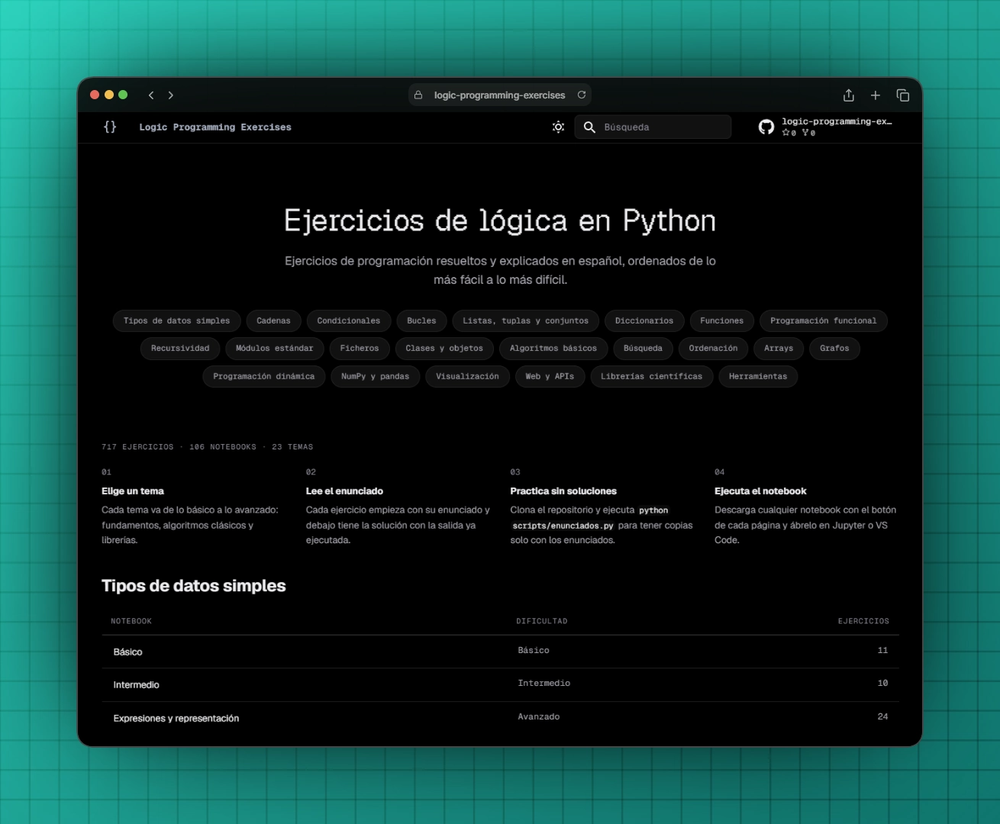

# Logic Programming Exercises

- 717 Python programming and logic exercises in 106 notebooks, solved and explained in Spanish
- Organized by topic and ordered from easiest to hardest
- Each exercise shows the statement followed by its solution, with outputs already rendered
- Covers language fundamentals, data structures, classic algorithms (searching, sorting, arrays, graphs, backtracking, greedy, dynamic programming) and popular libraries (NumPy, pandas, Matplotlib, Flask, TensorFlow, Qiskit...)
- Interactive Jupyter Notebook workflow
- Exercise index in [INDEX.md](INDEX.md) and a [static website](https://hectorolisan.github.io/logic-programming-exercises/) built with MkDocs



## Requirements

- Python 3.10 or newer
- `pip` (Python package manager)
- Internet connection for the notebooks that download data

## Installation

1. Clone the repository or download the project files.

2. Create a virtual environment:

```bash
python -m venv .venv
```

3. Activate the virtual environment:

```bash
source .venv/bin/activate     # Linux/macOS
.venv\Scripts\activate        # Windows
```

4. Install the dependencies:

```bash
pip install -r requirements.txt
```

Topics 01 to 18 only need `ipykernel`, `matplotlib` and `pytest`; the rest of the dependencies are used from topic 19 onwards.

## Project Structure

```
logic-programming-exercises/
├── public/
│   └── cover.webp
├── src/
│   ├── 01-tipos-datos-simples/      # Variables, operators, expressions, binary representation
│   ├── 02-cadenas/                  # Strings
│   ├── 03-condicionales/            # if / elif / else
│   ├── 04-bucles/                   # for / while, traces, simulations and games
│   ├── 05-listas-tuplas-conjuntos/  # Lists, tuples, sets, matrices, cellular automata
│   ├── 06-diccionarios/             # Dictionaries
│   ├── 07-funciones/                # Functions, applications, board games (chess, checkers...) and exceptions
│   ├── 08-programacion-funcional/   # map, filter, reduce, comprehensions, async, iterators, generators, decorators
│   ├── 09-recursividad/             # Recursion, fractals and backtracking
│   ├── 10-modulos-estandar/         # random, datetime, re, custom modules, testing and concurrency
│   ├── 11-ficheros/                 # Text, CSV, JSON, SQLite, internet files, interpreter
│   ├── 12-clases-objetos/           # Classes, records, dates, video store, data structures, modern Python
│   ├── 13-algoritmos-basicos/       # Complexity (Big O), Euclid, Union-Find, Huffman, greedy algorithms
│   ├── 14-busqueda/                 # Linear, binary, DFS, BFS
│   ├── 15-ordenacion/               # Bubble, selection, insertion, counting, merge, quick, heap
│   ├── 16-arrays/                   # Boyer-Moore, missing numbers, Kadane, Floyd, Quick Select, KMP
│   ├── 17-grafos/                   # Flood fill, Lee, topological sort, Dijkstra, Bellman-Ford, Floyd-Warshall, Kruskal, Prim, A*
│   ├── 18-programacion-dinamica/    # Subset sum, 0/1 knapsack, coin change, LCS, Levenshtein, LIS
│   ├── 19-numpy-pandas/             # NumPy and pandas
│   ├── 20-visualizacion/            # Matplotlib, seaborn, wordcloud, yfinance, bokeh
│   ├── 21-web-y-apis/               # requests, BeautifulSoup, Flask, MongoDB (mongomock)
│   ├── 22-librerias-cientificas/    # sympy, geopy, rdkit, simpy, scikit-image, qiskit, tensorflow
│   └── 23-herramientas/             # cryptography, logging, schedule, pypdf, openpyxl, cffi, pyinstaller, PyQt6, pygame, streamlit
├── scripts/
│   ├── index.py                     # Generates INDEX.md
│   ├── statements.py                # Copies the notebooks without solutions into statements/
│   └── mkdocs_hooks.py              # Fills the website home page with the index
├── docs/                            # Website home page, styles and build dependencies
├── overrides/                       # Material for MkDocs template (download button and credits)
├── .github/workflows/pages.yml      # Builds and publishes the website on GitHub Pages
├── mkdocs.yml                       # Website configuration
├── INDEX.md                         # Exercise index
├── requirements.txt                 # Project dependencies
├── .gitignore
├── LICENSE
└── README.md
```

Topic folders hold one or more notebooks numbered by difficulty (`01-basico`, `02-intermedio`, `03-avanzado`...) followed by notebooks with questions, traces and variants. Algorithm folders hold one notebook per algorithm, also ordered by difficulty.

### Dependencies

- `ipykernel`: Runs the notebooks with the virtual environment
- `pytest`: Testing exercises
- `matplotlib`, `seaborn`, `bokeh`, `wordcloud`: Charts and visualizations
- `numpy`, `pandas`, `sympy`, `simpy`, `scikit-image`, `geopy`, `rdkit`: Scientific computing
- `tensorflow`, `qiskit`, `qiskit-aer`: Neural networks and quantum computing (simulated)
- `requests`, `beautifulsoup4`, `lxml`, `yfinance`, `statsbombpy`: Web requests, scraping and online data
- `flask`, `pymongo`, `mongomock`, `streamlit`: Web applications, APIs and dashboards
- `cryptography`, `pypdf`, `openpyxl`, `schedule`: Security and automation
- `cffi`, `ziglang`: Calling C code (`ziglang` provides the C compiler)
- `pyinstaller`, `PyQt6`, `pygame`, `Pillow`: Executables, desktop interfaces and games

## Usage

1. Open any notebook in VS Code or Jupyter:

```bash
jupyter notebook src/01-tipos-datos-simples/01-basico.ipynb
```

2. Run the cells sequentially. Keep in mind that:
   - Some exercises ask for keyboard input with `input()`.
   - Some notebooks download data from the internet.
   - Files generated by the notebooks are saved next to them and ignored by Git (only `.ipynb` files are versioned in `src`).
   - Training the neural network (`22-librerias-cientificas/02-redes-neuronales`) and building executables (`23-herramientas`) take a few minutes.
   - Desktop programs (PyQt6, pygame) and web apps (Flask, Streamlit, Bokeh) are saved as scripts and tested without opening windows or servers; run them from the terminal to try them.

3. Practice without solutions: generate copies of the notebooks with only the statements (saved in `statements/`, ignored by Git):

```bash
python scripts/statements.py
```

4. Regenerate the exercise index after adding or renaming notebooks:

```bash
python scripts/index.py
```

5. Build the website (notebooks are not executed again, the saved outputs are used):

```bash
pip install -r docs/requirements.txt
mkdocs build
```

Every push to `main` publishes it on GitHub Pages through `.github/workflows/pages.yml` (set **Settings → Pages → Source** to **GitHub Actions** in the repository).

## Sources

The statements are adapted and translated from:

- [Ejercicios de Programación con Python](https://aprendeconalf.es/python-ejercicios/), Alfredo Sánchez Alberca ([CC BY-NC-SA 3.0 ES](https://creativecommons.org/licenses/by-nc-sa/3.0/es/)). Data files are downloaded from the author's repository.
- *Introducción a la Programación con Python*, Andrés Marzal and Isabel Gracia (all 484 exercises, adapted from Python 2 and the PythonG environment to Python 3 and Matplotlib)
- [Top 50 Ejemplos y Ejercicios](https://ellibrodepython.com/ejemplos-ejercicios-python), El Libro De Python
- [30 Days Of Python](https://github.com/Asabeneh/30-Days-Of-Python), Asabeneh Yetayeh. Data files are downloaded from its repository.
- Classic algorithms list (arrays, basics, searching, sorting and graphs)

All solutions are original.

## License

This project is licensed under the [CC BY-NC-SA 3.0 ES License](LICENSE), the same license as the [Ejercicios de Programación con Python](https://aprendeconalf.es/python-ejercicios/) statements it adapts ([legal code](https://creativecommons.org/licenses/by-nc-sa/3.0/es/legalcode.es)).

---

Developed by Héctor Olivares Sánchez.
